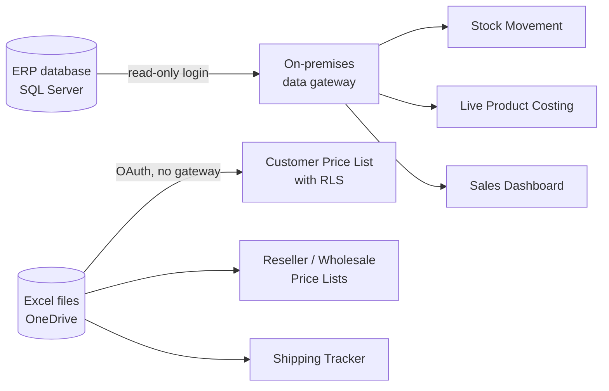

# Power BI + ERP Reporting Portfolio

Self-taught Power BI and SQL work built while working in production purchasing at a chemical
manufacturer. Every report replaced a manual Excel process with a live, automatically refreshed report
that reads directly from the ERP (Sage Evolution on SQL Server) or from shared Excel files.

> **All data in this repository is fictional.** Company names, customers, suppliers, products, prices,
> server names and credentials have been removed or replaced. The SQL, DAX and Power Query logic is
> the real logic, shown with generic names.

## Skills shown

| Area | What I used |
| --- | --- |
| SQL Server (T-SQL) | Joins across ERP views, rolling date windows, aggregation, discovery with `INFORMATION_SCHEMA`, validating totals against existing reports |
| Power BI | Import models, row-level security, slicers with search, conditional formatting, publishing and sharing |
| DAX | Measures (`SUMX`, `DIVIDE`, `SELECTEDVALUE`, `ALL`), calculated columns (`SWITCH`, `DATEDIFF`) |
| Power Query (M) | Cleaning Excel sources, custom columns, removing sensitive columns before load |
| Data platform | On-premises data gateway, scheduled refresh, read-only SQL login, OneDrive/SharePoint sources |
| Ways of working | Reverse-engineering existing reports, proving numbers match before going live, documenting everything |

## Architecture



## Projects

| # | Project | What it does | Key techniques |
| --- | --- | --- | --- |
| 1 | [Customer price list with row-level security](01-rls-price-list) | Each sales rep sees only their own customers' special prices; managers see everything | RLS roles, sharing rules, OneDrive refresh |
| 2 | [Stock movement and reorder report](02-stock-movement) | Rolling 6-month sales, stock cover in months and suggested order quantity, straight from the ERP | T-SQL, rolling dates, gateway, `SUMX` totals |
| 3 | [Live product costing](03-live-product-costing) | Recalculates the cost of hundreds of manufactured products from their recipes using today's raw material costs | BOM roll-up in SQL, validation against ERP screens |
| 4 | [Sales reporting from the ERP](04-sales-from-erp) | Rebuilt a monthly Excel sales report as a direct SQL source | Extracting report SQL, 5-part `UNION ALL`, reconciliation |
| 5 | [Price lists for the sales team](05-price-lists) | Reseller and wholesale price lists with cost and margin removed before they reach Power BI | Power Query clean-up, column-level safety |
| 6 | [Shipping / ETA tracker](06-shipping-tracker) | Cleaned an inbound shipping spreadsheet and turned it into a status board | Data cleaning, `SWITCH` flags, date handling |

See also: [Setup guide](docs/setup-guide.md) (SQL login, gateway, RLS, refresh) and [Lessons learned](LESSONS_LEARNED.md).

## Results

- Replaced several manual Excel exports with reports that refresh on a schedule.
- Live product cost matched the ERP's own costing screen exactly on test products to the cent on test products.
- Sales totals from SQL matched the existing Excel report for every financial year tested.
- Found that many saved costs in the ERP were years out of date - the live costing report makes this visible.

## Repository layout

```
01-rls-price-list/        RLS rules, sample data, write-up
02-stock-movement/        SQL, DAX, sample data
03-live-product-costing/  SQL (discovery + final), DAX, sample data
04-sales-from-erp/        approach and reconciliation (simplified SQL)
05-price-lists/           Power Query (M), sample data
06-shipping-tracker/      DAX flag logic, sample data, before/after cleaning
docs/setup-guide.md       step-by-step setup guide
```

The `.pbix` files are not included because they contain company data. The sample CSVs can be loaded
into Power BI Desktop to rebuild each report with the SQL/DAX shown.
